
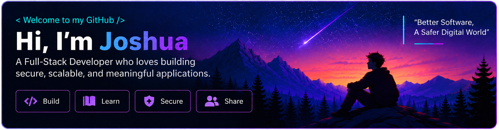

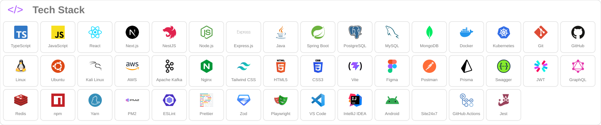

<table align="center" width="760">
<tr valign="top">
<td width="34%">
<h3 id="about-me"> About Me</h3>

I'm <strong>Joshua Aboga</strong>, a software engineering focused on full-stack development,
  backend systems, and DevSecOps. 
  I build secure, scalable applications that solve real-world problems.

</td>
<td width="33%"><h3 id="github-stats"> GitHub Stats</h3></td><td width="33%"><h3> Most Used Languages</h3></td>
</tr>
</table>

Language bars reflect public repository code composition, not proficiency. Statistics refresh through GitHub Readme Stats.

Explore the stack by category

My development and learning toolkit.

<table align="center" width="760">
<tr><th align="left" width="150">Languages &amp; Core Web</th><td> TypeScript&nbsp; 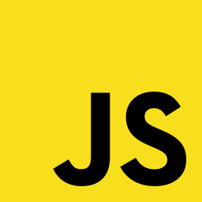 JavaScript&nbsp;  Java&nbsp;  HTML5&nbsp;  CSS3&nbsp; </td></tr>
<tr><th align="left" width="150">Frontend</th><td> React&nbsp; 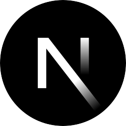 Next.js&nbsp;  Tailwind CSS&nbsp;  Vite&nbsp; </td></tr>
<tr><th align="left" width="150">Backend</th><td>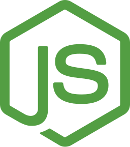 Node.js&nbsp;  Express.js&nbsp;  NestJS&nbsp;  Spring Boot&nbsp; </td></tr>
<tr><th align="left" width="150">Databases &amp; ORM</th><td> PostgreSQL&nbsp;  MySQL&nbsp; 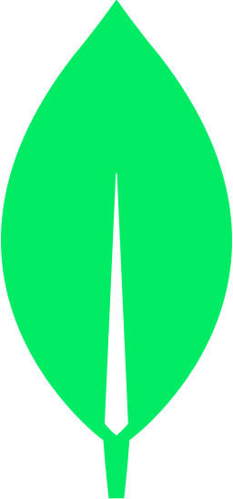 MongoDB&nbsp; 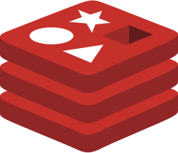 Redis&nbsp;  Prisma&nbsp; </td></tr>
<tr><th align="left" width="150">Cloud &amp; Infrastructure</th><td> Docker&nbsp;  Kubernetes&nbsp;  AWS&nbsp; 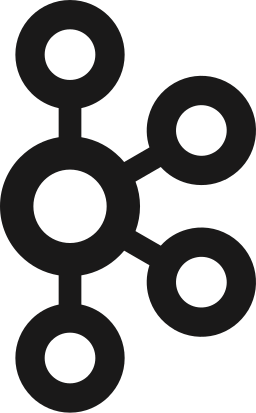 Apache Kafka&nbsp; 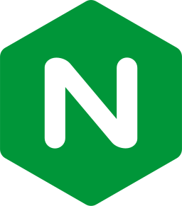 Nginx&nbsp;  Site24x7&nbsp;  PM2&nbsp; </td></tr>
<tr><th align="left" width="150">Operating Systems</th><td> Linux&nbsp;  Ubuntu&nbsp;  Kali Linux&nbsp; </td></tr>
<tr><th align="left" width="150">Version Control &amp; CI/CD</th><td>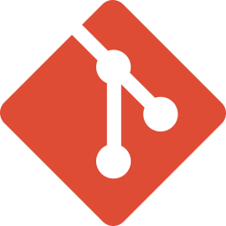 Git&nbsp;  GitHub&nbsp;  GitHub Actions&nbsp; </td></tr>
<tr><th align="left" width="150">APIs &amp; Security</th><td> Postman&nbsp; 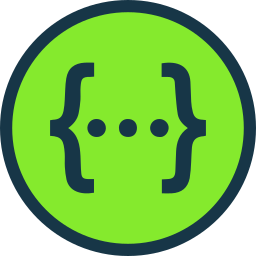 Swagger&nbsp; 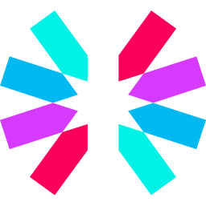 JWT&nbsp; 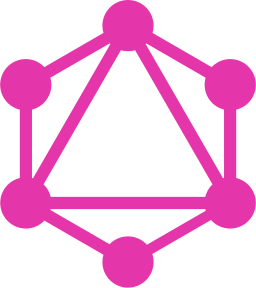 GraphQL&nbsp;  Zod&nbsp; </td></tr>
<tr><th align="left" width="150">Testing &amp; Code Quality</th><td> Jest&nbsp;  Playwright&nbsp; 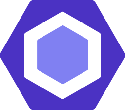 ESLint&nbsp; 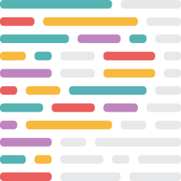 Prettier&nbsp; </td></tr>
<tr><th align="left" width="150">Design &amp; Development Tools</th><td>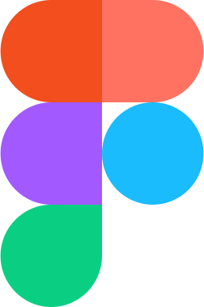 Figma&nbsp;  VS Code&nbsp;  IntelliJ IDEA&nbsp;  Android&nbsp;  npm&nbsp; 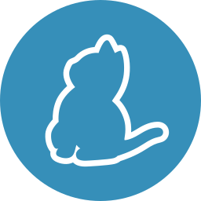 Yarn&nbsp; </td></tr>
</table>

