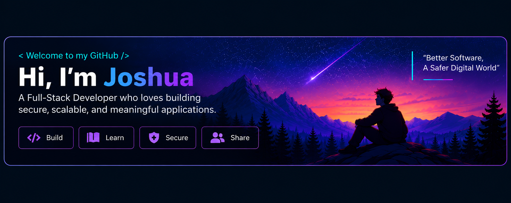
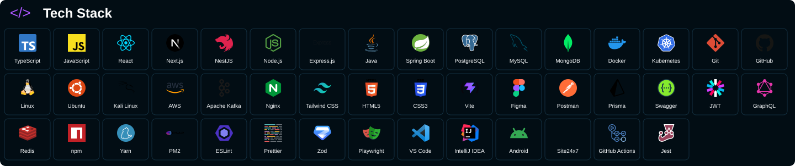

## Tech Stack

## About Me

I'm Joshua Andrew Aboga, a software engineering student and developer with a strong interest in full-stack development, backend systems, and DevSecOps.

I enjoy solving real-world problems, designing applications, building backend services, integrating databases, and exploring new technologies. My goal is to create secure, scalable, maintainable applications that make a positive impact.

## GitHub Stats

[View my current contributions and activity](https://github.com/fuinodev?tab=overview)

## Most Used Languages

[Explore the languages in my public repositories](https://github.com/fuinodev?tab=repositories)
